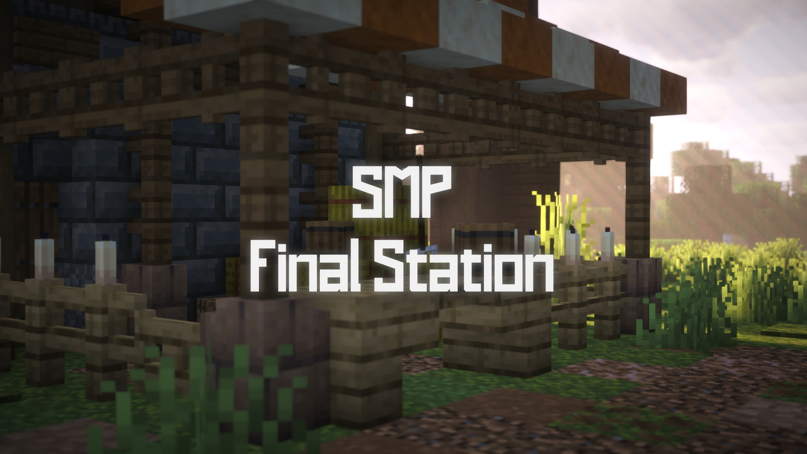

  

# The Final Station

Custom plugin sources, datapacks, Skripts and the resource pack for The Final Station Minecraft server. The current server runs Paper 26.3 with Java 25.

## Layout

| Folder | Contents |
| --- | --- |
| `Plugins/` | Active custom plugin projects; see [Plugins/README.md](Plugins/README.md) |
| `Datapacks/` | Maintained unpacked datapacks |
| `Resourcepack/` | Server resource pack |
| `Skripts/` | Server scripts |

## Custom plugins

| Plugin | Purpose |
| --- | --- |
| [SpawnGuard](Plugins/SpawnGuard-source/README.md) | Spawn and lead protection, vine growth and mob block-damage rules |
| [StatsPlugin](Plugins/StatsPlugin-source/README.md) | Statistics menus, leaderboards and player status tags |
| [PlaceableDecor](Plugins/PlaceableDecor-source/README.md) | Configurable collectible decorations, including Pikmin and hats |
| [Final Station Map](Plugins/FinalStationMap-source/README.md) | Pl3xMap port and web branding |

Build instructions are in each plugin's README. Downloads are available under [Releases](https://github.com/Tigrolino/Final-Station/releases).

## Datapacks

| Folder | Purpose |
| --- | --- |
| `all-achievements` | Completionist advancement |
| `custom-paintings` | Custom paintings used by the resource pack |
| [final-station-crafting](Datapacks/final-station-crafting/README.md) | Custom recipes |
| `final-station-guide` | Traveller's Guide book and updates |
| [murder-mystery](Datapacks/murder-mystery/README.md) | Murder mystery event |
| `painting-picker` | Painting selection through a stonecutter |
| `seedling-pikmin` | Seedlings, Pikmin rewards and cauldron recipes |
| `smelted-leather` | Rotten flesh to leather recipes |

## Skripts and resource pack

Skript files start with their commands, permissions and dependencies. They cover ranks, worlds, whitelist management, height, announcements and server events. Some require LuckPerms, Multiverse, Geyser or Floodgate.

The resource pack contains custom hats, staffs, paintings, guide-book artwork and Seedling/Pikmin models.

## Style and credits

See [STYLE.md](STYLE.md) for formatting and project layout.

Final Station work by Tigrolino and The3dGamerz. StatsPlugin originated with StarMaster. Pl3xMap and the included parser retain their upstream attribution. Third-party datapacks retain their authors' metadata.

The repository's own work is covered by [LICENSE](LICENSE). Upstream components retain their own licenses.
